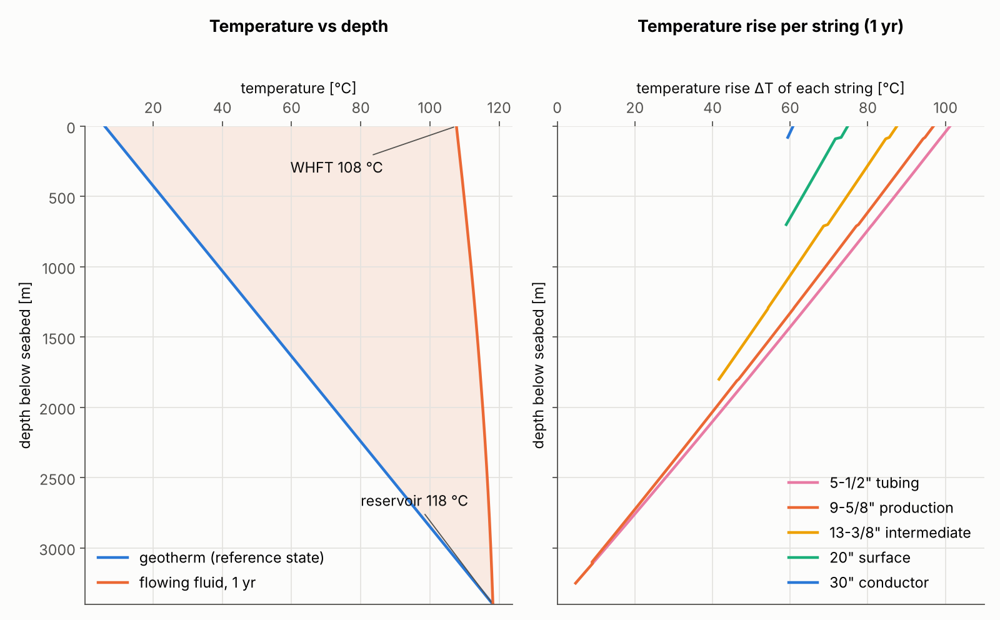
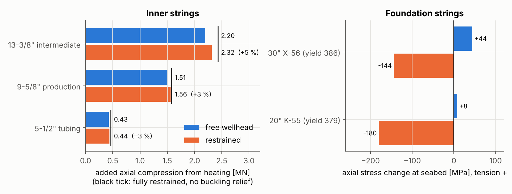
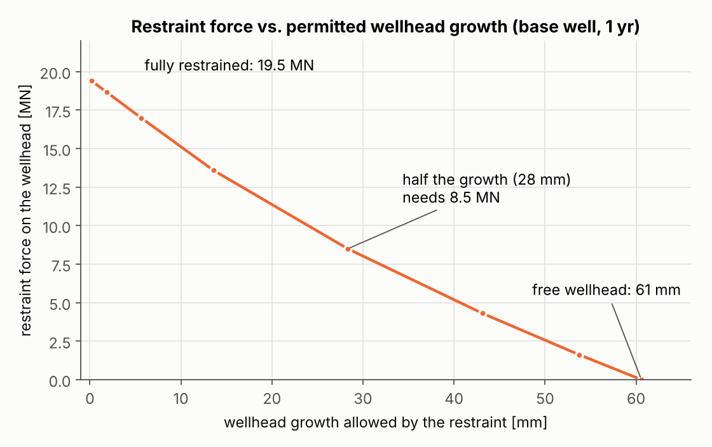
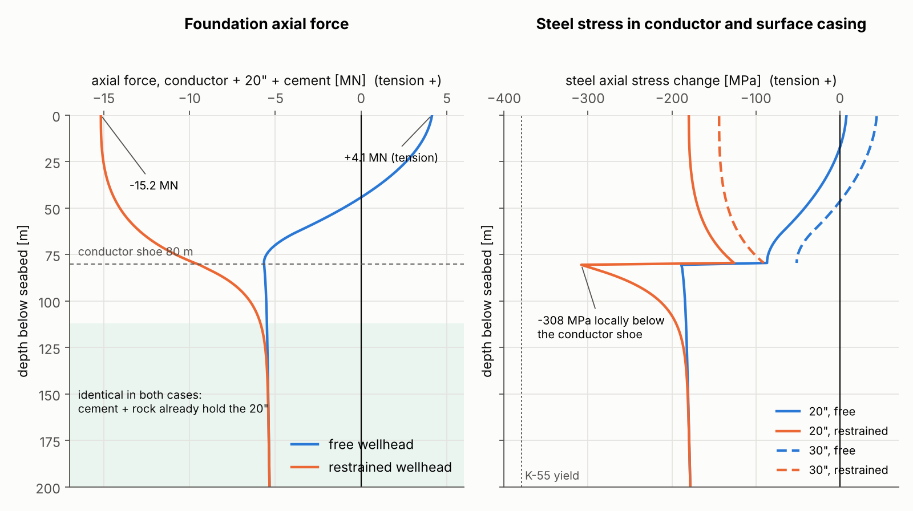
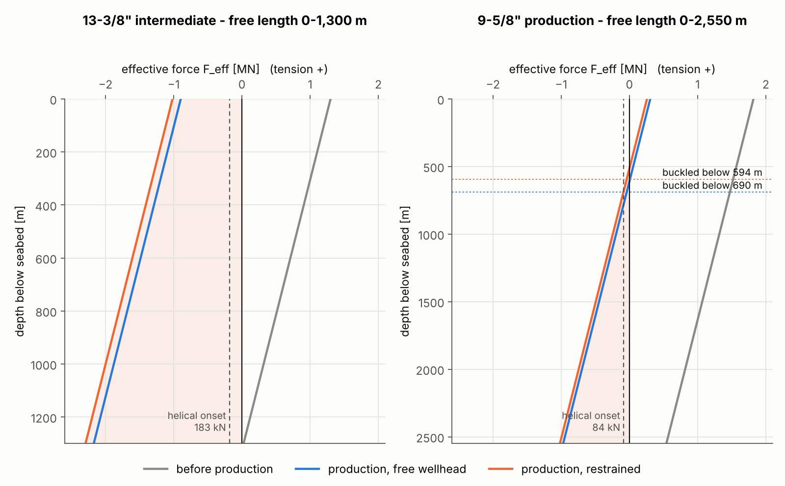

# Restraining wellhead growth in a subsea well: what happens to the casings?

*Worked example with standard API casing sizes. The numbers come from the 1-D model in [`analysis/`](../analysis), which can be re-run.*

---

## 1. Short answer

**Restricting wellhead growth does not remove the thermal expansion. It turns the expansion into force.** Where that force ends up depends on how stiff each part of the well is:

1. **The inner casing strings (13⅜", 9⅝") and the tubing are already almost fully restrained in a normal subsea well.** The conductor and the cemented surface casing are more than 100× stiffer axially than a long, free inner string. A free wellhead therefore grows only about **61 mm**, while a free 13⅜" section would like to grow **1.14 m**. With a free wellhead the inner strings already carry **90–96 %** of the fully restrained thermal compression. Holding the wellhead adds only the last **3–5 %**.
2. **Yes, the casings buckle.** In the free (uncemented) sections the effective force becomes compressive. In a vertical hole the critical load is tiny (≈ 0.08–0.18 MN), so these sections buckle into a **helix confined by the outer casing**:
   - the 13⅜" over its whole free length (0–1 300 m);
   - the 9⅝" below ≈ 600 m;
   - the tubing below ≈ 1 150 m.

   This happens **with or without the restraint**. The restraint makes it only slightly worse: the 9⅝" neutral point moves about 100 m higher.
3. **In this example the buckling is elastic.** Peak von Mises stress is 229 MPa in the 13⅜" L-80 (42 % of yield) and 155 MPa in the 9⅝" P-110 (20 %). Helical bending adds up to ~57 MPa. The contact force against the outer string is ~1.9 kN/m.
4. **The real cost of the restraint lands on the foundation and on the restraint itself.**
   - The conductor and surface casing can no longer expand at the seabed. Their thermal strain becomes compression: about **−144 MPa in the 30"** and **−180 MPa in the 20"** (≈ 47 % of K-55 yield) from heating alone.
   - Just below the conductor shoe, where the restrained conductor hands its compression over to the 20", the 20" reaches **≈ −308 MPa locally** (≈ 81 % of yield, model estimate). With a free wellhead the same point is at −189 MPa.
   - Below about 110 m the two cases are identical: cement and rock already lock the surface casing completely. The whole difference sits in the top ~100 m, where soft soil lets the conductor slide (§4a).
   - The restraint must hold down about **19.5 MN (≈ 2 000 t)**.
   - Even halving the growth takes ≈ 8.5 MN.
5. **There is one case where the restraint changes things dramatically for a casing:** a surface casing that is *not* cemented to the seabed. With a 200 m free length of 20" inside the conductor, restraining the wellhead raises the 20" compression from 2.5 MN to 4.2 MN (+68 %). The 20" then buckles into a ~53 m-pitch helix inside the conductor (σ_vM ≈ 236 MPa, 62 % of yield).

**Complete video (recommended):** `deliverables/restrained_wellhead_growth_complete.mp4` (≈ 27 min). It has chapter markers and English subtitles, in three parts:

- Part 1: the physics.
- Part 2: free vs. restrained, side by side.
- Part 3: answers to four follow-up questions (§10).

The two parts also exist as separate videos, each with English subtitles in the `.srt` next to it:

- **The full explainer:** `deliverables/restrained_wellhead_growth_explainer.mp4` (12.4 min).
- **A side-by-side comparison of the free and restrained cases:** `deliverables/free_vs_restrained_wellhead_comparison.mp4` (≈ 7 min).

---

## 2. The example well

Depths are in metres below the seabed. The well is a vertical oil producer in 350 m of water (Norwegian Continental Shelf style, 18¾" 15 k subsea wellhead).

| String | Pipe (API 5CT) | Grade | Hole | Shoe | Top of cement | Free length |
|---|---|---|---|---|---|---|
| Conductor | 30" × 1" WT (310 ppf) | X-56 | 36" | 80 m | seabed | – |
| Surface casing + 18¾" HPWH | 20" 133 ppf | K-55 | 26" | 700 m | seabed (base case) | – (200 m in variant) |
| Intermediate | 13⅜" 72 ppf | L-80 | 17½" | 1 800 m | 1 300 m | **1 300 m** |
| Production | 9⅝" 53.5 ppf | P-110 | 12¼" | 3 250 m | 2 550 m | **2 550 m** |
| Liner | 7" 29 ppf | P-110 | 8½" | 3 600 m | full | – |
| Tubing | 5½" 17 ppf | 13Cr-80 | – | packer 3 100 m | – | 3 100 m |

**Section properties used**

| Pipe | OD / ID [mm] | Steel area [cm²] | EA [MN] | EI [MN·m²] | E·A·α [kN/°C] |
|---|---|---|---|---|---|
| 30" × 1" | 762.0 / 711.2 | 587.8 | 12 167 | 826 | 150.9 |
| 20" 133 ppf | 508.0 / 475.7 | 249.2 | 5 159 | 156 | 64.0 |
| 13⅜" 72 ppf | 339.7 / 313.6 | 134.0 | 2 773 | 37.1 | 34.4 |
| 9⅝" 53.5 ppf | 244.5 / 216.8 | 100.3 | 2 076 | 13.9 | 25.7 |
| 5½" 17 ppf | 139.7 / 124.3 | 32.0 | 663 | 1.45 | 8.2 |

Steel properties: E = 207 GPa, ν = 0.30, α = 12.4·10⁻⁶ /°C (the API TR 5C3 value, 6.9·10⁻⁶ /°F).

**Fluids**

| Location | Fluid |
|---|---|
| A-annulus | 1.03 SG brine (pressure managed through the XT) |
| B-annulus | 1.40 SG mud |
| C-annulus | 1.25 SG mud |
| 20" | run riserless, seawater displacement |

Each top of cement is placed **below the previous shoe**, so the B and C annuli are open to formation. Annular pressure build-up (APB) is therefore not a dominant load here (see §8).

**Load path.**
- Each casing hanger lands on a load shoulder in the high-pressure housing (HPWH) and is held by a seal assembly and a lockdown ring.
- The HPWH lands and locks in the low-pressure (conductor) housing.
- Downward loads go hanger → HPWH → 20" / 30" (bonded by cement) → soil.
- An inner string that pushes upward loads its hanger lockdown, and that force is reacted by the same 20"/30"/soil system.

---

## 3. How the temperature is applied

The reference (stress-free) state is the condition when the cement set. The casing was then at the undisturbed geotherm: **6 °C at the seabed + 3.3 °C/100 m, ≈ 118 °C at the reservoir (3 400 m)**. Every load below comes from the **temperature change from this state**: ΔT(z) = T_prod(z) − T_ref(z).

This is conservative. Circulation during cementing usually warms the upper part slightly, which would reduce ΔT.

**Flowing temperature.** Liquid flows at about 3 000 m³/d (30 kg/s, c_p = 2 400 J/kg·K). The flowing temperature follows Ramey's (1962) energy balance with the Hasan–Kabir transient formation function f(t):

dT_f/dx = −(T_f − T_geo)/A − βTg/c_p, with A = ṁ·c_p·R′_tot (relaxation distance).

- R′_tot is the radial thermal resistance per metre of well, from the flowing fluid to the undisturbed rock.
- The last term is the small net gravity/Joule-Thomson cooling for a liquid.
- At high rate A is ≈ 25–30 km, so the fluid loses only ~10 °C on the way up. The **wellhead flowing temperature (WHFT) is ≈ 108 °C**.
- The difference between the flowing fluid and the rock is largest near the seabed (≈ 100 °C) and goes to zero at the reservoir.

**Radial heat transfer.** At every depth the heat flows outward through layers in series:

- tubing film and wall;
- A-annulus brine (natural convection, k_eff ≈ 4 W/m·K);
- 9⅝";
- B-annulus mud (k_eff ≈ 1);
- 13⅜";
- C-annulus mud;
- 20";
- cement (0.9);
- 30";
- cement;
- formation (k = 2.0 W/m·K, diffusivity 8.3·10⁻⁷ m²/s, transient resistance f(t)/2πk).

The configuration changes with depth as strings, cement and open hole start and stop. Just below the seabed after one year:

| Layer | Share of total resistance |
|---|---|
| tubing + A-annulus | 5 % |
| B-annulus | 9 % |
| C-annulus | 12 % |
| cement (+30") | 21 % |
| **formation** | **52 %** |

Because the formation is the largest resistance, the casings sit much closer to the oil temperature than to the rock temperature. Temperature rise just below the seabed after 1 year of production:

| Tubing | 9⅝" | 13⅜" | 20" | 30" |
|---|---|---|---|---|
| +101 °C | +97 °C | +87 °C | +75 °C | +61 °C |

The temperature rise falls roughly linearly with depth and reaches zero at the reservoir (Fig. 2).

- Average temperature rise over the free lengths: **71 °C for the 13⅜"** (0–1 300 m), **61 °C for the 9⅝"** (0–2 550 m) and 56 °C for the tubing.
- The inner strings heat within hours. The outer strings and the rock follow over weeks to months. After 6 h the conductor has risen +23 °C, after 1 month +48 °C and after 1 year +61 °C, so the loads keep creeping up (Fig. 5).



*Fig. 2 – Left: geotherm (reference state) and flowing fluid temperature. Right: temperature rise of each string.*

---

## 4. Mechanics: thermal strain, restraint and the spring analogy

**Thermal strain.** ε_th = α·ΔT. If a free length L could move, it would grow by

δ_free = α ∫₀ᴸ ΔT dz

- 13⅜": 1.14 m;
- 9⅝": 1.94 m;
- tubing: 2.15 m.

**Restraint.** Each free section is fixed in cement at the bottom (top of cement or packer) and hung from the wellhead at the top. If the ends cannot move, the total strain must be zero: σ/E + αΔT = 0, so **σ = −E·α·ΔT ≈ −2.57 MPa per °C**. In force terms, F = E·A·α·ΔT_avg:

| String | Fully restrained compression |
|---|---|
| 13⅜" 72 ppf | 34.4 kN/°C → 2.43 MN |
| 9⅝" 53.5 ppf | 25.7 kN/°C → 1.58 MN |
| Tubing | 0.46 MN |

**Spring analogy.** Each free string acts as a pre-strained spring with stiffness k = EA/L:

| String | k [MN/m] |
|---|---|
| 13⅜" | 2.13 |
| 9⅝" | 0.81 |
| Tubing | 0.21 |

The foundation is the conductor + 20" + cement composite gripped by the soil. Its effective (secant) stiffness is ≈ 240 MN/m, more than 100× stiffer than the inner strings. In the linear limit the wellhead equilibrium is the classic

δ_WH = Σ kᵢ δᵢ / Σ kᵢ

In the model the foundation is solved properly:
- It is an axial bar with its own thermal strain on non-linear t–z soil springs.
- Soil strength is s_u = 10 + 2z kPa; adhesion 0.6; peak friction is reached at 1 % of the diameter (API RP 2GEO style).
- The soil near the seabed is weak, so the hot upper part of the conductor/20" slides and expands upward on its own.

**Result with a free wellhead: growth = 61 mm.**
- 44 mm comes from the foundation's own thermal expansion in the soft near-seabed soil.
- 17 mm comes from the ≈ 4.1 MN upward push of the inner strings.

Compared with the 1.1–2.2 m the inner strings "want", 61 mm is almost nothing. With a free wellhead the inner strings already carry 2.20 MN (13⅜", 90 %), 1.51 MN (9⅝", 96 %) and 0.43 MN (tubing, 93 %) of their fully restrained compression.

**Result with the wellhead restrained (δ_WH = 0):**

| Quantity | Free wellhead | Restrained | Change |
|---|---|---|---|
| Wellhead growth | 61 mm | 0 | – |
| 13⅜" added compression | 2.20 MN | 2.32 MN | +5 % |
| 9⅝" added compression | 1.51 MN | 1.56 MN | +3 % |
| Tubing added compression | 0.43 MN | 0.44 MN | +3 % |
| 30" axial stress change at seabed | +44 MPa | **−144 MPa** | −188 MPa |
| 20" axial stress change at seabed | +8 MPa | **−180 MPa** | −188 MPa |
| Restraint force on wellhead | 0 | **19.5 MN (≈ 2 000 t)** | – |

- The restrained inner strings stay ~5 % below the "fully restrained" values because **helical buckling gives back a little length**: 52 mm for the 13⅜", 21 mm for the 9⅝", 97 mm for the tubing.
- The restraint reaction is the sum of the foundation's own blocked thermal force (~15.2 MN at the seabed) and the inner strings' push (~4.3 MN).



*Fig. 6 – Added compression of the inner strings (left) and stress change in the foundation strings at the seabed (right).*

**Partial restraint** (a spring of stiffness k_r at the wellhead) sits on a nearly straight line between the two limits. Allowing half the growth (28 mm) still needs 8.5 MN (Fig. 4).



*Fig. 4 – Restraint force needed versus the wellhead growth the restraint allows.*

---

## 4a. Free vs. restrained, side by side

**Forces on the wellhead (1 year).**

| | Free | Restrained |
|---|---|---|
| Inner strings push up | 4.1 MN | 4.3 MN |
| Conductor + 20" at the seabed | pulls down 4.1 MN (tension) | pushes up 15.2 MN (blocked thermal expansion) |
| Restraint | – | pushes down 19.5 MN |
| Wellhead movement | +61 mm | 0 |

**Where the difference sits (Fig. 7).**
- **Free wellhead.** The top of the conductor/20" composite is in tension (+4.1 MN), because it holds the inner strings back. A few tens of metres down, soil friction takes over and the composite's own thermal expansion turns into compression.
- **Restrained wellhead.** The full thermal compression (≈ −15 MN) reaches all the way up to the wellhead.
- **Below ≈ 110 m the curves are identical.** Cement and rock already hold the 20" completely, so it carries its full restrained thermal stress (≈ −181 MPa) in both cases.
- **The conductor shoe.** In the restrained case the conductor's compression has to be handed to the 20" and the soil at the conductor shoe. This gives a local peak of ≈ −308 MPa in the 20" just below 80 m (model estimate, sensitive to how load transfers at the shoe), against −189 MPa with a free wellhead.



*Fig. 7 – Axial force in the conductor + 20" + cement composite (left) and steel stress in the 20" and 30" (right), free vs. restrained wellhead.*

**Time and cycling.**
- The free wellhead grows ≈ 32 mm after 1 day, 41 mm after 1 week, 49 mm after 1 month and 61 mm after 1 year.
- With the wellhead restrained, the force over the same times is 11.9, 14.5, 16.6 and 19.5 MN.
- Every shut-in and start-up cycles the movement (free) or the full force (restrained). For a restrained well this is a fatigue load on the restraint, the conductor and the wellhead housing.

**Scoreboard**

| Quantity | Free | Restrained | Change |
|---|---|---|---|
| Wellhead growth | 61 mm | 0 | – |
| 13⅜" added compression | 2.20 MN | 2.32 MN | +5 % |
| 9⅝" added compression | 1.51 MN | 1.56 MN | +3 % |
| 9⅝" buckled below | 690 m | 594 m | +96 m buckled pipe |
| 13⅜" max von Mises | 217 MPa | 229 MPa | 39 → 42 % of yield |
| 13⅜" hanger uplift | 0.91 MN | 1.04 MN | +13 % |
| 30" stress at seabed | +44 MPa | −144 MPa | −188 MPa |
| 20" stress at seabed | +8 MPa | −180 MPa | −188 MPa |
| 20" peak (below conductor shoe) | −189 MPa | ≈ −308 MPa | 50 → 81 % of yield |
| Restraint force | 0 | 19.5 MN | ≈ 2 000 t |

---

## 5. Effective force and buckling

Buckling of a fluid-filled pipe in fluid is governed by the **effective force** (Lubinski et al., 1962), not by the true axial force in the steel:

F_eff = F_a − p_i·A_i + p_o·A_o

**Load history in the model, per string:**

1. **Cementing.** The hanging buoyant weight is frozen in. Below the top of cement the pipe was surrounded by 1.90 SG slurry when it set.
2. **Fluid changes before production**, solved as ballooning with fixed ends: ΔF_a = 2ν·Δ(p_i·A_i − p_o·A_o). For example, the inside of the 9⅝" changes from 1.40 SG mud to 1.03 SG brine.
3. **Production heating.** The change of axial force is uniform along a free section with fixed ends. It follows from compatibility:

   ΔF·L/EA + α∫ΔT dz − ∫ε_buckle dz = δ_WH

**Before production** the 13⅜" effective force is +1.30 MN at the wellhead and ≈ 0 at the top of cement. Heating shifts the whole profile by −2.32 MN (restrained case). It becomes compressive over the whole free length: −1.02 MN at the wellhead and −2.29 MN at the top of cement. The 9⅝" carries more hanging weight, so only its lower part goes into compression: below 690 m with a free wellhead, below 594 m when restrained (Fig. 3).

**Critical loads in a vertical well.** Wu & Juvkam-Wold give

- sinusoidal onset: F_s = 2.55 (EI·w²)^⅓
- helical onset: F_h = 5.55 (EI·w²)^⅓

That is **0.18 MN for the 13⅜"** and **0.08 MN for the 9⅝"**. These are tiny compared with the MN-level thermal loads, because a vertical hole has no low side for gravity to hold the pipe against. The compressed sections therefore wrap into a **helix pressed against the outer casing or hole wall**.



*Fig. 3 – Effective force before production, in production with a free wellhead, and in production restrained. Shading: compressive (buckled) zone.*

**Helical buckling quantities** (Lubinski / Mitchell):

- pitch p = π·√(8EI/F)
- bending stress σ_b = D·r_c·F / (4I)
- contact force w_c = r_c·F² / (4EI)
- buckling shortening ΔL/L = r_c²·F / (4EI)

Here r_c is the radial clearance: 68 mm for 13⅜" in 20", 52 mm in 17½" hole, 35 mm for 9⅝" in 13⅜".

| Restrained case | 13⅜" | 9⅝" | Tubing |
|---|---|---|---|
| Buckled length | 0–1 300 m (all) | 594–2 550 m | 1 140–3 100 m |
| Max compressive F_eff | 2.29 MN | 1.02 MN | 0.38 MN |
| Min helix pitch | 36 m | 33 m | 17 m |
| Max bending stress | 57 MPa | 31 MPa | 72 MPa |
| Max contact force | 1.86 kN/m | 0.62 kN/m | 0.94 kN/m |
| Helix dogleg | 2.8 °/30 m | 2.1 °/30 m | 8.6 °/30 m |
| Buckling shortening | 52 mm | 21 mm | 97 mm |
| Max von Mises (axial + bending + Lamé pressure) | 229 MPa (42 % of L-80) | 155 MPa (20 % of P-110) | 197 MPa (36 % of 13Cr-80) |

With a free wellhead the same quantities are only a few percent lower:

| Free wellhead | 13⅜" | 9⅝" |
|---|---|---|
| Max von Mises | 217 MPa | 150 MPa |
| Buckled from | 0 m | 690 m |

**Cemented sections do not buckle.** The cement gives lateral support. They simply carry the local restrained thermal stress, −E·α·ΔT. The same applies to the conductor and 20" when cemented to the seabed: soil and cement support them laterally, and the critical load of the composite on an elastic foundation is far above the applied load.

---

## 6. Variant: 20" surface casing not cemented to the seabed

If losses leave the 20" top of cement at 200 m below the seabed, the 20" has its own free length inside the conductor (radial clearance ≈ 100 mm) and the 26" hole. The HPWH is then reacted only by the conductor in soil. This configuration is known to strongly affect wellhead movement and surface casing stress (de Souza et al., 2022; de Souza, 2020).

| | Free wellhead | Restrained |
|---|---|---|
| Wellhead growth | 70 mm | 0 |
| 20" added compression | 2.51 MN | **4.22 MN (+68 %)** |
| 20" F_eff range (0–200 m) | −2.2 to −2.7 MN | **−4.0 to −4.4 MN** |
| 20" helix pitch / bending | 68 m / 41 MPa | **53 m / 70 MPa** |
| 20" von Mises | 141 MPa (37 %) | **236 MPa (62 % of K-55)** |
| Restraint force | – | 18.1 MN |

Here the restraint changes the outcome for a casing string. The 20" goes from moderate to heavy helical buckling, with larger contact loads on the conductor and higher bending at the HPWH/20" transition.

---

## 7. What to check if growth is restricted

- **Foundation and restraint.**
  - The restraint must carry the full reaction, ~20 MN here.
  - The conductor/20" near the seabed see 150–190 MPa of extra compression, on top of wellhead weight, riser/BOP loads and fatigue loading.
  - The 20" just below the conductor shoe sees the peak (≈ −308 MPa locally in this model). Check this location explicitly.
  - The HPWH/LPWH interface and any template or suction-anchor connection must be checked for this load.
- **Casing hanger lockdown.** The top of the 13⅜" is in compression (true axial force ≈ −1.0 MN at the hanger). The hanger pushes up on its lockdown ring, and lift-off would endanger the annulus seal.
- **Connections.** They must be rated for compression plus helical bending; API buttress compression efficiency is limited.
- **Wear.** Helix contact forces of ~1–2 kN/m wear both strings during later intervention or drilling.
- **Load cycling.** Each shut-in and restart cycles these loads. If yield were exceeded, cooling after a shut-in would leave residual tension.
- **APB.** Not significant in this design because the annuli are open to formation (see §8).

**Ways to reduce the problem if growth must be limited:**
- Reduce ΔT, for example with vacuum-insulated tubing or insulating packer fluid.
- Make sure the surface casing is cemented to the seabed.
- Design hanger lockdowns, connections and the foundation for the fully restrained load.
- Otherwise, design the tie-in (jumpers, spools) to accept the growth rather than fight it.

---

## 8. Assumptions and limitations

- **1-D axial model.**
  - Vertical well.
  - Single production state (1 year of steady flow).
  - Constant section along each free length; coupling clearance is ignored, though couplings reduce r_c.
  - No friction from buckling contact, which would make the force distribution non-uniform.
- **Reference temperature = undisturbed geotherm.** This is conservative.
- **Thermal model.**
  - Quasi-steady wellbore with transient formation (Ramey / Hasan–Kabir).
  - Wellbore heat capacity is ignored, so the first hours are approximate.
  - Annulus conductivities are fixed effective values.
- **Annulus pressures are held constant during production** (annuli open to formation, A-annulus managed). A *trapped* annulus would add APB of order 0.5–1 MPa per °C of fluid heating. Through ballooning and the effective force, APB stabilises the inner string and destabilises the outer one.
- **Tubing pressure effects** (piston, ballooning on the packer) are not modelled. The tubing is included only for its thermal push on the wellhead.
- **Foundation soil** is an elastic–perfectly-plastic t–z model with generic North Sea clay parameters. The initial friction state from the wellhead and BOP weight is ignored. **Wellhead growth and restraint force are sensitive to soil and cement assumptions.** The conclusions about the inner strings are not, because they depend only on the inner strings being much softer than the foundation.
- **Buckling thresholds.** Wu & Juvkam-Wold (vertical) are used. Their exact values do not matter here because the loads are 10× larger. Deviated wells have higher critical loads (Dawson & Paslay), so less buckling in the deviated parts.
- **Not a design verification.** Use a validated multi-string tool (for example WellCat or StressCheck) with actual well data, and with connection, hanger and wellhead ratings, for any real decision.

---

## 9. Reproducing the results

```bash
pip install numpy scipy matplotlib
python analysis/run_cases.py      # writes analysis/results/results.json
python analysis/make_figures.py   # writes report/figures/*.png
```

The videos are generated from `video/`. Narration: `narration.py` (main) or `compare/narration_cmp.py` (comparison), voiced by `make_tts.py [--variant compare]` with the Kokoro-82M neural TTS. Animation: Manim Community scenes `scenes_a…e.py` and `compare/scenes_cmp_a…d.py`, rendered with `VIDEO_VARIANT=compare` for the comparison. Assembly: `build_video.py [--variant compare]`. `analysis/export_compare.py` writes the full-resolution foundation profiles used in Fig. 7 and the comparison video.

---

## 10. Follow-up questions and answers

These are answered in Part 3 of the complete video.

**Q1. How much of the restraint force is in the surface casing vs. the conductor, and why are the forces so high?**

At the seabed, the 19.5 MN restraint force comes from:

| Source | Force | Share |
|---|---|---|
| 30" conductor | 8.5 MN | 43 % |
| 20" surface casing | 4.5 MN | 23 % |
| Cement between and around them | 2.2 MN | 11 % |
| Inner strings | 4.3 MN | 22 % |

The forces are high for four reasons:
- Blocked thermal expansion gives σ = E·α·ΔT ≈ 2.57 MPa/°C, whatever the pipe size. At the seabed ΔT is 61 °C for the 30" and 75 °C for the 20", giving ≈ 156 / 192 MPa if fully blocked.
- Force = stress × steel area, and these are heavy pipes:

  | Pipe | Steel area | Force per °C |
  |---|---|---|
  | 30" × 1" | 588 cm² | 151 kN/°C |
  | 20" 133 ppf | 249 cm² | 64 kN/°C |
  | 13⅜" 72 ppf (for comparison) | 134 cm² | 34 kN/°C |

- Cement and soil hold them sideways, so they cannot buckle to shed load.
- They are very stiff. Every millimetre of growth prevented costs ≈ 0.32 MN.

**Q2. Doesn't length matter?**

Not for the force.
- Free growth α·L·ΔT grows with L.
- Stiffness EA/L falls with L.
- So F = E·A·α·ΔT is independent of length. A 1,300 m, 650 m and 10 m piece of the same 13⅜" at 71 °C all need 2.43 MN to hold.

Length does matter for:
- the movement that must be prevented;
- the length of soil needed to anchor the force. The conductor needs roughly the top 60–100 m; below ≈ 110 m cement and rock lock the 20" locally;
- how much a given wellhead movement relieves a string (see Q4).

**Q3. What are the buckling and yield limits?**

See the table below. "Yields when buckled" means axial compression plus helical bending at the outer wall.

| String | Pipe-body yield | Buckling onset, vertical (sinusoidal / helical) | Yields when buckled | Load, restrained case |
|---|---|---|---|---|
| 30" X-56 | 22.7 MN | none (soil/cement support: 60–280 MN) | – | 8.5 MN (−144 MPa) |
| 20" K-55, cemented | 9.45 MN | none | – | −180 MPa at seabed; ≈ −308 MPa (81 % of yield) below conductor shoe |
| 13⅜" L-80 | 7.40 MN | 0.08 / 0.18 MN | 5.2–5.6 MN | 2.3 MN |
| 9⅝" P-110 | 7.60 MN | 0.04 / 0.08 MN | 5.8 MN | 1.0 MN effective |
| 5½" 13Cr-80 | 1.77 MN | 0.01 / 0.02 MN | 1.1 MN | 0.4 MN effective |

- Buckling is confined and stable, so the relevant limit for a buckled string is the "yields when buckled" column.
- At 30° inclination the 13⅜" helical onset rises to ≈ 1.5 MN.
- A fully blocked pipe starting from zero stress would yield at ΔT ≈ 150 °C (K-55, X-56), 215 °C (L-80, 13Cr-80) or 295 °C (P-110).

**Q4. Why are the inner casings "already locked in"?**

Both ends of each free section are fixed:
- the bottom by cement;
- the top by the hanger on its load shoulder plus the lockdown ring.

The only relief is the wellhead rising (61 mm) and helix shortening.

| String | Wants to grow | Wellhead relieves | Helix relieves | Still blocked |
|---|---|---|---|---|
| 13⅜" | 1,138 mm | 61 mm | 48 mm | 90 % of full force |
| 9⅝" | – | – | – | 96 % |
| 5½" tubing | – | – | – | 93 % |

Why the wellhead moves so little:
- The conductor/20" behaves like a ≈ 240 MN/m spring.
- The inner strings are ≤ 2.1 MN/m each.
- Their ≈ 4 MN push lifts the wellhead only ≈ 17 mm; the other 44 mm is the conductor's own expansion.

Why length is decisive here:
- The same 61 mm would relieve a 100 m free section by ≈ 70 %.
- It relieves a 1,300 m section by only ≈ 5 %.

The only real "unlock" would be the hanger sliding up, which is a seal failure. Load is reduced by less heat, more hanging tension, and stronger pipe and connections.

---

## 11. References

- Lubinski, A., Althouse, W.S., Logan, J.L. (1962). *Helical Buckling of Tubing Sealed in Packers.* JPT 14(6), SPE-178-PA.
- Mitchell, R.F. (1988). *New Concepts for Helical Buckling.* SPE Drilling Engineering, SPE-15470-PA.
- Wu, J., Juvkam-Wold, H.C. (1995). *Buckling and Lockup of Tubulars in Inclined Wellbores.* J. Energy Resour. Technol. 117(3):208. Also Wu, J. (1992), Ph.D. dissertation, Texas A&M (vertical-well coefficients 2.55 / 5.55).
- Dawson, R., Paslay, P.R. (1984). *Drillpipe Buckling in Inclined Holes.* JPT, SPE-11167-PA.
- Ramey, H.J. (1962). *Wellbore Heat Transmission.* JPT 14(4), SPE-96-PA.
- Hasan, A.R., Kabir, C.S. (1994). *Aspects of Wellbore Heat Transfer During Two-Phase Flow.* SPE Production & Facilities 9(3).
- de Souza, C.O., de Sousa, J.R.M., Ellwanger, G.B., da Silva, E.C.C.M., Fang, J. (2022). *Surface Casing Buckling Effect on the Wellhead Movement of a Subsea Well.* Mathematical Problems in Engineering, doi:10.1155/2022/9591383.
- de Souza, C.O. (2020). *Wellhead Movement in Subsea Wells with Partially Cemented Surface Casing.* D.Sc. thesis, COPPE/UFRJ.
- *Casing thermal stress and wellhead growth behavior analysis* (2014). Petroleum Science 11:131–138, doi:10.1007/s12182-014-0324-7. Theoretical and FE growth predictions within 10 % of field measurements.
- Halal, A.S., Mitchell, R.F. (1994). *Casing Design for Trapped Annular Pressure Buildup.* SPE Drilling & Completion, SPE-25694-PA.
- API TR 5C3 / ISO 10400. *Calculating performance properties of casing, tubing and line pipe.*
- API RP 2GEO. *Geotechnical and Foundation Design Considerations* (t–z curves).
- NORSOK D-010. *Well integrity in drilling and well operations.*

*Note on sources: web access in the research environment was limited to search summaries. Several primary texts (PetroWiki, the Hindawi/Wiley full text) could not be opened, so the formulas are the standard published forms and have not been quoted from those pages.*
